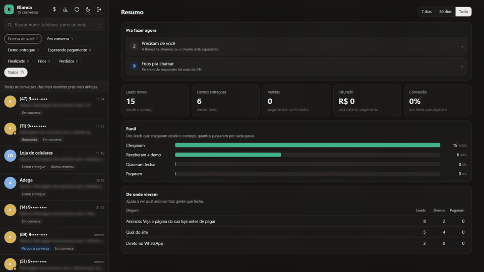
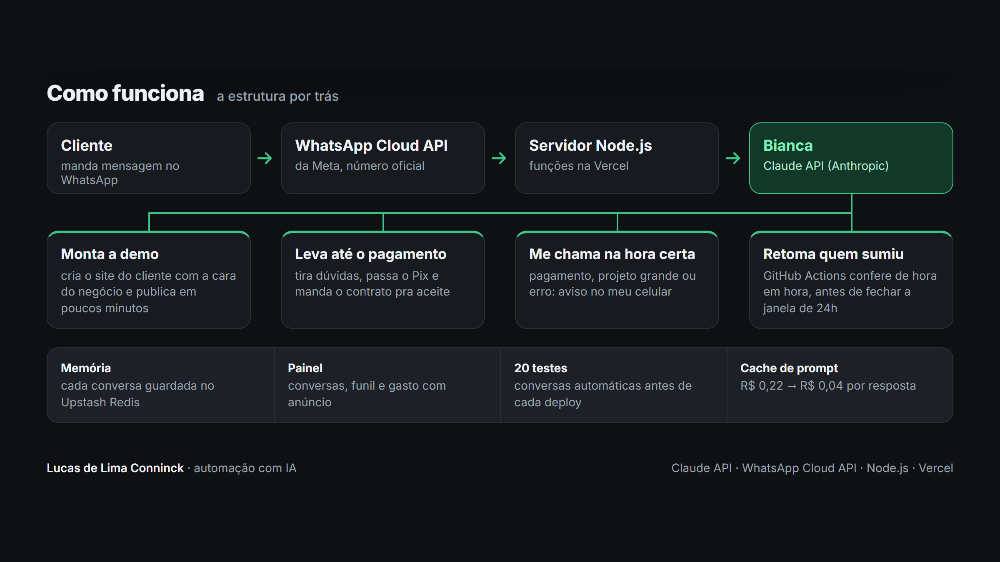

# Bianca: AI sales agent on WhatsApp

**Bianca** is the AI agent that runs the WhatsApp sales of my web design business, 24 hours a day. She has been in production since **November 10, 2026**, talking to real leads that come from Meta Ads.

[Versão em português abaixo](#-versão-em-português)

> The video uses **sample data**. Phone numbers are masked and the conversation shown is an example, so no real client data appears here.
> Full-quality video: [docs/painel-demo.mp4](docs/painel-demo.mp4)

## What she does, on her own

- **Answers every lead** coming from the ads, at any hour
- **Qualifies**: asks about the business, the city and what the client needs
- **Builds a custom demo website** for each lead and publishes it in a few minutes
- **Handles the close**: answers objections, sends the Pix payment details and the contract
- **Calls me at the right moment**: payment, a large project or any error triggers a notification on my phone
- **Follows up** with leads who went quiet, before WhatsApp's 24-hour window closes

## Results so far

| | |
|---|---|
| Live since | Nov 10, 2026 |
| Conversations handled (first 8 days) | 15 |
| Demo websites built and delivered by her | 6 |
| Cost per reply | **R$ 0.22 → R$ 0.04** (about 5x cheaper) after prompt caching and picking the right model for each task |
| Automated test conversations before every deploy | 20 |

## How it works

| Part | Tech |
|---|---|
| Brain | Claude API (Anthropic), with prompt caching |
| Channel | WhatsApp Cloud API (Meta, official number) |
| Server | Node.js serverless functions on Vercel |
| Memory | Upstash Redis (one record per conversation) |
| Scheduled follow-ups | GitHub Actions running every hour |
| Dashboard | Custom web app in the style of WhatsApp Web: conversations, sales funnel, revenue and ad spend (Meta Ads API) |

## What I learned building it

1. **The prompt is the product.** Before each update, Bianca goes through 20 automated test conversations. If one breaks, the update does not ship.
2. **Cost decides if the idea survives.** Prompt caching and routing simple tasks to a smaller model cut the cost per reply by about 5x.
3. **A good AI knows when to call a human.** Closing a sale, a big project or an error: she hands off to me right away.

## About the code

The source code is private because it holds client conversations and the business playbook. I'm happy to walk through it live in an interview.

I built Bianca with **Claude Code** as my programming partner: I design the flows, the prompts, the tests and the product, and I review and ship every change.

## Contact

**Lucas de Lima Conninck**, AI automation and performance marketing, Londrina, Brazil (remote).
[LinkedIn](https://www.linkedin.com/in/lucas-de-lima-conninck) · [lucaslimaweb.com.br](https://lucaslimaweb.com.br)

---

## 🇧🇷 Versão em português

A **Bianca** é a atendente de IA que cuida das vendas da minha empresa de sites pelo WhatsApp, 24 horas por dia. Ela está no ar desde **10 de novembro de 2026**, atendendo clientes de verdade que chegam pelos anúncios da Meta.

**O que ela faz sozinha**
- Responde quem chega pelo anúncio, a qualquer hora
- Entende o negócio do cliente e o que ele precisa
- Monta e publica um site de demonstração personalizado pra cada cliente
- Tira dúvidas, passa o Pix e manda o contrato
- Me chama na hora certa: pagamento, projeto grande ou erro
- Retoma a conversa com quem sumiu, antes de fechar a janela de 24h do WhatsApp

**Números:** 15 conversas e 6 demos nos primeiros 8 dias. O custo por resposta caiu de R$ 0,22 para R$ 0,04 com cache de prompt e o modelo certo pra cada tarefa. Antes de cada atualização, 20 conversas de teste automáticas.

**Tecnologia:** Claude API (Anthropic) · WhatsApp Cloud API · Node.js na Vercel · Upstash Redis · GitHub Actions. Painel próprio no estilo do WhatsApp Web, com conversas, funil, faturamento e gasto com anúncio.

O vídeo e o print usam **dados de exemplo**: telefones mascarados e uma conversa fictícia. O código fica privado porque guarda conversas de clientes, mas eu mostro tudo numa entrevista.

Feito com o **Claude Code** como parceiro de programação.
